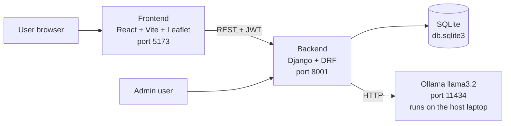

# LebanonAI

AI tourist companion for Lebanon. Final year project, Computer Engineering (IoT), Politehnica University of Bucharest.

Team: Hussein Mokhadder, Tiouchichine Adel, Zayyad Saeed. Course master: Andrei Vasilateanu.

LebanonAI helps tourists, students and retired visitors find hotels, restaurants, places and activities in Lebanon. It has an AI chat that answers only from the stored listings, a map, bookings with WhatsApp, offers by user segment, reviews, hiking routes, a voice guide, and a dashboard for the Ministry of Tourism.

## Architecture



Docker runs the frontend and the backend. Ollama (the AI model) runs on the host laptop, not in a container.

## Services

| Service | Technology | Port | Runs in Docker |
|---|---|---|---|
| frontend | React 19, Vite, Leaflet, Tailwind | 5173 | yes |
| backend | Django 5.2, Django REST Framework, SimpleJWT | 8001 | yes |
| database | SQLite file (backend/db.sqlite3) | none | inside backend |
| AI model | Ollama with llama3.2 | 11434 | no, on the host |
| ollama (optional) | Ollama container | 11435 | only with `--profile ollama`, not tested |

## Install and run with Docker

You need Docker Desktop and Ollama.

1. Get the code and the model:

```
git clone https://github.com/Hussein026/lebanon-ai-tourist.git
cd lebanon-ai-tourist
git switch develop
ollama pull llama3.2
```

2. Make the secret file. Copy `backend/.env.example` to `backend/.env`, then set a long random `SECRET_KEY`:

```
copy backend\.env.example backend\.env
python -c "from django.core.management.utils import get_random_secret_key; print(get_random_secret_key())"
```

Paste the printed key into `backend/.env` after `SECRET_KEY=`. Never commit `.env`.

3. Start Ollama (the app must be open), then:

```
docker compose up -d --build
```

On the first start the backend runs the migrations and loads the 60 listings from `backend/core/fixtures/listings_snapshot.json`.

4. Open http://localhost:5173

5. Create an admin and a Ministry user:

```
docker compose exec backend python manage.py createsuperuser
docker compose exec backend python manage.py shell -c "from django.contrib.auth.models import User, Group; g,_=Group.objects.get_or_create(name='ministry'); u=User.objects.create_user('ministry_user', 'ministry@example.com', 'PASSWORD'); u.groups.add(g)"
```

Replace PASSWORD with a strong password. Stop everything with `docker compose down`.

## Install and run without Docker

You need Python 3.11, Node 22 and Ollama.

```
cd backend
pip install -r requirements.txt
copy .env.example .env
python manage.py migrate
python manage.py loaddata core/fixtures/listings_snapshot.json
python manage.py createsuperuser
python manage.py runserver 8001
```

In a second terminal:

```
cd frontend
npm install
npm run dev
```

Open http://localhost:5173. The chat needs Ollama running, with `ollama pull llama3.2` done.

## Configuration (backend/.env)

| Variable | Meaning |
|---|---|
| SECRET_KEY | Django secret key. Required. The server will not start without it. |
| DEBUG | True or False. Default False. |
| ALLOWED_HOSTS | Comma list, for example localhost,127.0.0.1 |
| OLLAMA_URL | Set by docker-compose. Default http://localhost:11434/api/chat |

## API

Base address: http://localhost:8001/api/ . Login returns a JWT. Send it as `Authorization: Bearer <access token>`.

### Listings (public, read)

| Method | Address | Description |
|---|---|---|
| GET | /hotels/, /restaurants/, /places/, /activities/, /taxis/ | List with search and filters. `/<id>/` gives one item. |

### Users

| Method | Address | Description |
|---|---|---|
| POST | /auth/register/ | Create an account. Fields: username, email, password, segment (tourist, student, retired). Checks email and password strength. |
| POST | /auth/login/ | Returns user data and tokens (access, refresh). |
| GET | /auth/profile/ | Own profile, including private health fields. Login required. |
| POST | /auth/token/refresh/ | New access token from a refresh token. |

### AI chat

| Method | Address | Description |
|---|---|---|
| POST | /chat/ | Body: message, optional session_id. Returns session_id, message, sources, grounded. Answers only from stored listings. If there is no data, it says it has no information. Shows up to 5 results. English only. |

### Bookings (login required)

| Method | Address | Description |
|---|---|---|
| GET, POST | /bookings/ and /bookings/me/ | List own bookings, or create one. Status starts as pending. Checks guests, phone, dates. |
| GET, PUT, PATCH, DELETE | /bookings/<id>/ | Own booking only. |

### Offers, reviews, routes, recommendations

| Method | Address | Description |
|---|---|---|
| GET | /offers/ | Offers for the user's segment. |
| GET | /reviews/summary/?type=hotel | Average rating and count per listing. |
| GET | /reviews/?type=hotel&id=1 | Reviews of one listing. |
| POST | /reviews/ | Create or update own review. Fields: listing_type, listing_id, rating 1 to 5, comment. Login required. |
| GET | /routes/ | Hiking routes. |
| GET | /recommendations/ | Recommendations for the user's segment. |

### Ministry dashboard (Ministry group or superuser only)

| Method | Address | Description |
|---|---|---|
| GET | /analytics/dashboard/ | Totals, bookings by type, top items, monthly bookings, users per segment. No login gives 401, other users give 403. |
| PATCH | /analytics/bookings/<id>/status/ | Set a booking to pending, confirmed or cancelled. |

### Admin

http://localhost:8001/admin/ lets a superuser add, edit and delete hotels, restaurants, places and activities.

## Security

- Secret key, DEBUG and allowed hosts come from `backend/.env`. `.env`, the database and Python cache files are not tracked by Git.
- Register checks username length, email format and password strength.
- Bookings check guests, phone, dates and text length. Users see only their own bookings.
- The dashboard needs the Ministry role.
- Health data is private. It is never sent to the AI model.
- The old `.env` still exists in Git history. The secret key was replaced. Treat anything that was in the old file as public.

## Known limits

- WhatsApp numbers exist for only 10 of 60 listings.
- 16 hotel and restaurant photos come from web sources and are not cleared for reuse.
- Accessibility data exists for 3 hotels only. Offers are SAMPLE offers, not real discounts.
- Place fees and opening hours are not verified.
- The voice guide covers 10 places.
- The chat answers in English only. The interface is English only.
- The AI runs on CPU. A warm answer takes about 3 to 12 seconds, the first one after a restart about 30 seconds.
- Not built: photo recognition, payments, mobile app, PostgreSQL, a public online address.

## Project files

- `docs/SPRINT_BACKLOG.md` and `docs/USER_STORIES.md`: sprint work.
- `docs/image_credits.csv` and `docs/text_credits.csv`: sources of images and texts.
